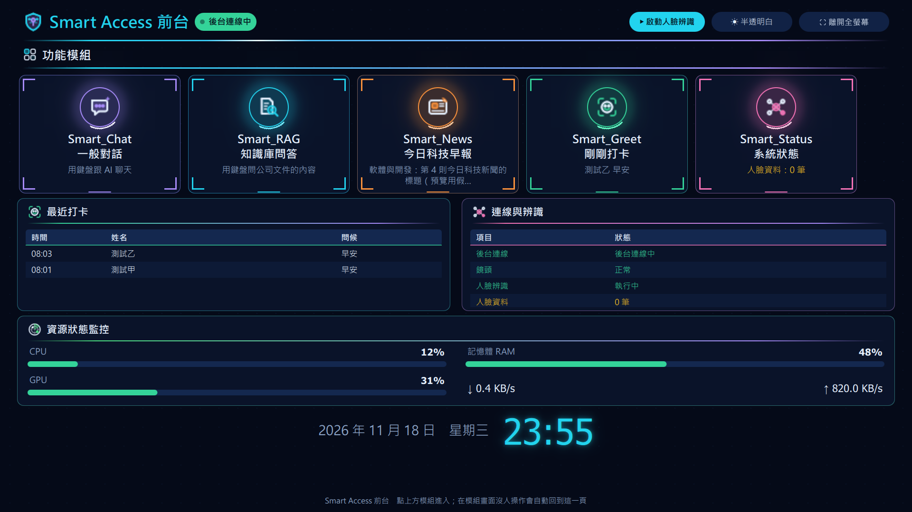
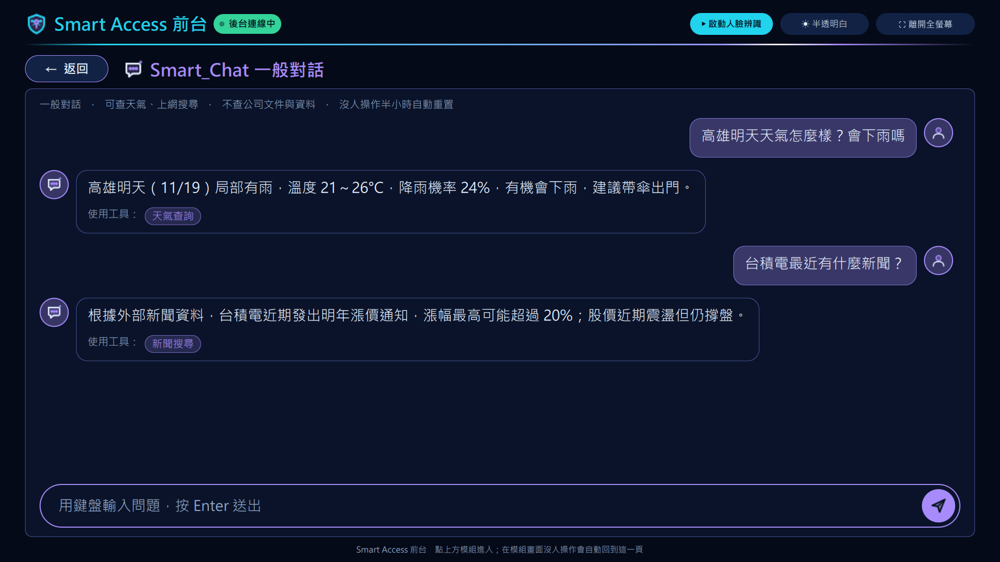
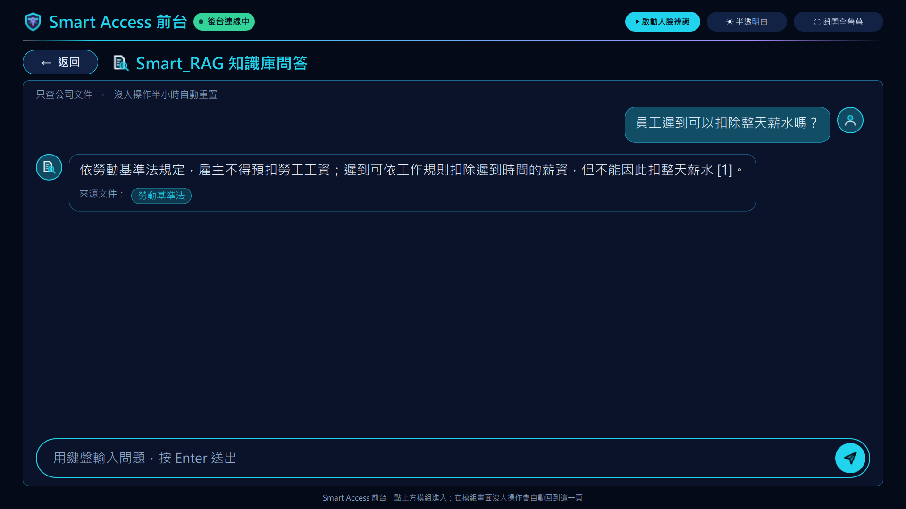

<div align="center">

# Smart Access Agent System

**智慧門禁 × 企業知識庫：人臉辨識打卡在前台，文件問答與出缺勤查詢的運算全在後台。**




</div>

> [!TIP]
> 只想先看畫面？不需要模型、攝影機、後台或網路，裝好依賴後一行指令就能開前台（假資料）：
> `python -m access.front_preview`

## 目錄

- [重點特色](#重點特色)
- [這個專案做什麼](#這個專案做什麼)
- [架構：兩台電腦](#架構兩台電腦)
- [功能模組](#功能模組)
- [快速開始](#快速開始)
- [兩台電腦怎麼部署](#兩台電腦怎麼部署)
- [專案結構](#專案結構)
- [常見問題](#常見問題)
- [測試與品質把關](#測試與品質把關)
- [安全現況與已知限制](#安全現況與已知限制)
- [文件導覽](#文件導覽)
- [參與開發](#參與開發)

## 重點特色

- **前台零設定、零上網**：不能改設定、不保存對話，只能由前台主動連後台；後台離線時用本機快取繼續辨識，恢復後補送。
- **回答有依據**：文件問答只查 `data/docs`，找不到就說找不到；回答裡的數字會對照原文，對不上會警告。
- **真的 MCP 工具、不花錢**：Smart_Chat 用官方 MCP SDK 連天氣、新聞、維基、台股報價與讀網頁，全部免費、免金鑰；全本地模式整組停用。
- **運算集中在後台**：向量模型、重排、語言模型都在後台，前台只送問題、取回答。
- **可驗證**：單元測試不需模型與 GPU；前後台各有驗證腳本，前台能自動回傳驗證報告給後台。
- **誠實的限制清單**：活體偵測的誤判率、沒有登入的元件都寫在 [安全現況](#安全現況與已知限制)，不宣稱已經安全。

## 這個專案做什麼

| 你是 | 你得到 |
|---|---|
| 員工 | 到前台刷臉打卡（活體偵測、尾隨偵測），打卡成功有語音問候；在前台螢幕問公司文件、問一般問題、看科技早報 |
| 管理者 | 後台人臉登入，管理帳號與員工註冊（手機掃 QR Code 註冊）、看出缺勤報表與異常事件、查詢出缺勤、每天自動產生出勤日報 |
| 開發者 | 前台、後台、知識庫各自獨立的模組；單元測試不需要模型、GPU、攝影機或任何服務 |

設計上的取捨：

- **前台只做前台的事**：不上網、沒有設定或管理員功能、不保存任何對話、永遠由前台主動連後台。
- **運算集中在後台**：向量模型、重排、語言模型都在後台，前台只送問題、取回答。
- **回答要有依據**：Smart_RAG 只查 `data/docs` 的文件，找不到依據就明說，不亂回答；回答裡的數字會對照原文檢查。

## 架構：兩台電腦

```text
 前台電腦（RTX 5070，不上網）                      後台電腦（RTX 4060，可上網）
┌───────────────────────────────┐   乙太網路    ┌──────────────────────────────────────┐
│ 人臉辨識 / 活體 / 尾隨 / 語音   │  169.254.x.x  │ 資料庫、管理後台（CustomTkinter）     │
│ 儀表板（PySide6 + QML）        │ ───────────▶ │ 連線服務（HTTPS 8770、UDP 探測 8772）  │
│ Smart_Chat / Smart_RAG 畫面    │  前台主動連線 │ 知識庫（bge-m3 + 重排 + FAISS/BM25）   │
│ 本機快取人臉 + 離線佇列         │ ◀─────────── │ 語言模型（本機 Ollama 或雲端）+ MCP 工具 │
└───────────────────────────────┘               └──────────────────────────────────────┘
```

- 連線是 **前台發起的 HTTPS**：自簽憑證用指紋比對、通行碼放環境變數；前台用 UDP 自動尋找後台位址。
- 後台離線時前台用本機快取繼續辨識，打卡事件先排進持久佇列，恢復連線後補送。
- 詳細的協定與威脅對策見 [docs/adr/0001-front-knowledge-chat.md](docs/adr/0001-front-knowledge-chat.md)。

## 功能模組

功能模組名稱一律以 `Smart_` 開頭。

**前台**

| 模組 | 說明 |
|---|---|
| Smart_Chat 一般對話 | 語言模型加 MCP 工具：天氣、新聞、維基百科、台股報價、讀公開網頁，全部免費、免金鑰；記得最近 6 輪，半小時沒人問就重置；沒有任何公司內部資料 |
| Smart_RAG 知識庫問答 | 只查 `data/docs` 的文件（PDF、Word、txt、md），回答附來源文件名稱 |
| Smart_News | 科技早報（後台抓取，前台第二螢幕顯示，每則附原文 QR Code） |
| Smart_Greet | 打卡問候與紀錄 |
| Smart_Status | 連線、辨識與警示狀態 |

<table>
<tr>
<td></td>
<td></td>
</tr>
<tr><td align="center">Smart_Chat：用工具查天氣與股價</td><td align="center">Smart_RAG：依文件回答並標示來源</td></tr>
</table>

Smart_Chat 實際問答（2026-11-19 在前後台兩台電腦上跑出來的結果，節錄）：

| 問題 | 用到的工具 | 回答重點 |
|---|---|---|
| 台北明天天氣如何 | 天氣查詢 | 氣溫 15～19°C、降雨機率 53%，註明是外部氣象資料 |
| 台積電目前股價多少 | 新聞搜尋（現在有股價查詢工具，可直接查證交所行情） | 2,175 元，附資料日期；2330 的 11/18 收盤價與證交所一致 |

**後台**

| 模組 | 說明 |
|---|---|
| Smart_Monitor | 營運狀態、前台連線、停止前台辨識、連線檢查 |
| Smart_Accounts | 管理者帳號（最後一位管理者不能被取消、停用或刪除） |
| Smart_Register | 員工註冊，手機掃 QR Code |
| Smart_Query | 出缺勤查詢聊天（只查考勤與異常，不載入知識庫模型） |
| Smart_Report | 報表、異常事件、對話紀錄審查 |
| Smart_Digest | 出勤日報與排程 |

## 快速開始

需求：Windows、Python 3.11。模型檔（約數 GB）不在 repo 內，要自行放進 `models/`；清單見 [deploy/build_front_bundle.py](deploy/build_front_bundle.py) 的 `MODEL_FILES`，另外後台需要 `bge-m3` 與 `bge-reranker-v2-m3`。

```powershell
# 1) 建環境（順序不能反；沒有 NVIDIA 顯卡的安裝說明在 requirements/main.txt 檔頭）
python -m venv .venv
.venv\Scripts\pip install torch==2.13.0+cu126 torchvision==0.28.0+cu126 --index-url https://download.pytorch.org/whl/cu126 --extra-index-url https://pypi.org/simple
.venv\Scripts\pip install -r requirements/main.txt -c requirements/lock.txt
.venv\Scripts\pip install retinaface==1.1.1 --no-deps

# 2) 單元測試（不需要模型、GPU、攝影機）
.venv\Scripts\python -m pytest tests -q

# 3) 啟動：一律在專案根目錄用 python -m，不要直接執行檔案
.venv\Scripts\python -m admin.backend_main      # 後台（先人臉登入）
.venv\Scripts\python -m access.terminal_app     # 門禁現場主程式
.venv\Scripts\python -m access.front_preview    # 前台畫面預覽（假資料，不需後台與模型）
```

只改前台畫面的人：不需要模型、攝影機、後台或網路，看 [前台開發指南.md](前台開發指南.md)。

金鑰一律走環境變數（例如 `NVIDIA_API_KEY`、`SMART_ACCESS_LINK_TOKEN`），不寫進檔案。

## 兩台電腦怎麼部署

1. **後台**：以系統管理員執行 `deploy\設定後台網路.bat`（只放行 169.254.0.0/16 的 TCP 8770 與 UDP 8772），再用 `deploy\檢查後台網路.bat` 逐項確認。
2. **打包前台**：`python -m deploy.build_front_bundle` 產生 `dist\SmartAccessFront.zip`（只含前台程式與模型，不含資料與後台程式）。
3. **前台**：解壓後雙擊「安裝前台.bat」（輸入與後台相同的通行碼）、「前台檢查.bat」確認各項沒有失敗。
4. **啟動**：後台雙擊「展示啟動.bat」；前台雙擊「啟動前台.bat」，人臉辨識由儀表板右上角按「啟動」。
5. **驗證**：後台用 `python -m admin.front_verify_report` 讓前台自動跑一輪問答並回傳報告；完整的三層測試見 [雙機測試.md](雙機測試.md)。

前台連不上後台時，後台「檢查連線」按鈕與前台儀表板狀態列會顯示原因（找不到後台、憑證指紋不符、被拒絕等）。

## 專案結構

<details>
<summary>展開目錄說明</summary>

```text
shared/   資料庫、路徑、角色設定、連線協定、工作日曆、對話紀錄、共用主題
access/   門禁（人臉與活體 vision_core、尾隨 security、語音 audio_player、QR 註冊 web_server）
          與前台（front_qt 儀表板、front_agent 連線代理、front_chat 問答控制）
admin/    管理後台 backend_main、連線服務 link_server、日報與科技早報、前台自動驗證
rag/      知識庫（doc_store、檢索、重排、問答 answer）、Smart_Chat（talk、MCP 用戶端與內建伺服器）
deploy/   前台打包與安裝腳本、網路設定腳本
assets/   自己畫的 SVG 圖示
tests/    unit（不需外部資源）、integration（真模型與真行程）、regression（對照基準）
docs/     架構決策紀錄 adr/、README 用圖
```

</details>

## 測試與品質把關

```powershell
python -m pytest tests                      # 單元測試（2026-11-19 本機實跑：1979 個通過）
python -m pytest -m integration             # 整合測試：真模型、真法規、真行程（只在本機）
python -m pytest -m regression              # 回歸測試，對照 tests/regression/baseline.json
python -m rag.evaluation.retrieval_eval     # 知識庫檢索評估（hit@k、MRR）
```

- CI：Ruff、Bandit、Semgrep、CodeQL、Dependabot，以 diff 範圍把關；PR 必須通過單元測試與視窗測試（xvfb 虛擬螢幕）。
- CI 環境沒有 PySide6、MCP 套件與模型檔，相關測試會自動跳過，只在本機整合測試實際執行。
- 前後台真機驗證：後台雙擊「驗證當天.bat」（13 項引導驗證，報告寫在 `runtime/verification/`），前台雙擊「前台驗證.bat」。

## 安全現況與已知限制

這個專案**不宣稱已經安全**。已做與沒做的事：

- 後台啟動先人臉登入（只比對管理者；連續 5 幀距離與活體分數都要過；失敗 5 次鎖 60 秒；閒置 15 分鐘登出）。
- 前後台連線：TLS 加密、憑證指紋比對、通行碼；Smart_Chat 的工具只收 https 公開網域、擋內網位址，全本地模式整組停用。
- 限制：活體模型對照片與螢幕翻拍的防禦不夠強（EER 約 8% 到 14%）；擋不住能直接讀寫檔案與資料庫的人；門禁終端機與 QR 註冊伺服器本身沒有登入；遠端測試入口只靠存取金鑰，只適合少數人短期測試。
- 活體模型的訓練在獨立的 `Antispoof-Training` repo，本專案只使用匯出的 ONNX。

## 常見問題

<details>
<summary>前台一直顯示「後台離線」</summary>

先在後台按「檢查連線」，再看前台儀表板狀態列的原因：找不到後台（網路線、`設定後台網路.bat`）、憑證指紋不符（後台重新產生了憑證，需要更新前台記住的指紋）、通行碼不符（兩邊的 `SMART_ACCESS_LINK_TOKEN` 要一樣）。
</details>

<details>
<summary>Smart_RAG 說「資料中沒有提到」，但文件明明有</summary>

多半是檢索沒撈到那一條。先用 `python -m rag.evaluation.retrieval_eval` 看檢索評估，再用同一題確認正確條文有沒有進候選；口語詞與正式用語不同（例如「特休」與「特別休假」）時最常發生。
</details>

<details>
<summary>Smart_Chat 查不到天氣或新聞</summary>

天氣與新聞來自第三方免費服務，可能暫時連不上或限流；工具失敗時它會照實說查不到，不會編造。後台開了全本地模式時工具會整組停用。
</details>

## 文件導覽

| 文件 | 內容 |
|---|---|
| [CLAUDE.md](CLAUDE.md) | 專案要點與開發規則（結構、啟動方式、資安現況、修改流程） |
| [前台開發指南.md](前台開發指南.md) | 只改前台畫面的工程師入口 |
| [雙機測試.md](雙機測試.md) | 三層測試：單機真行程、前台包安裝、跨機實測 |
| [明天驗證流程.md](明天驗證流程.md) | 前後台真機驗證的步驟 |
| [GitHub新手指南.md](GitHub新手指南.md) | 第一次用 GitHub 的組員：分支、PR |
| [docs/adr/](docs/adr/) | 架構決策紀錄 |

## 參與開發

1. 從 `main` 開自己的分支，不要直接改 `main`。
2. 改完先跑 Ruff 與單元測試，再開 PR；涉及認證、SQL、檔案、網路或模型輸入的變更要另做資安審查。
3. 風格：檔案開頭用 docstring 寫用途、功能、串接模組；函式一行註解；不寫「某日修了某事」這類歷史註解。

授權：尚未指定授權條款（repo 為私人）。
